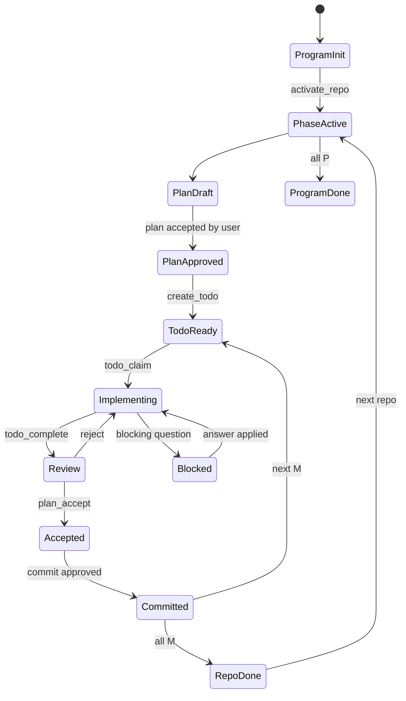

# Workflow MCP 设计文档（需求 + 设计）

> 状态：草稿 v0.1　日期：2026-11-24
> 目的：把我们在 FUT 新系统多仓开发中形成的流程、模板、问题和护栏固定下来，设计成一个可被其他 Claude Code / agent 复用的 MCP 工具。
> 读者：负责实现该 MCP 工具的开发者。
>
> **Provenance:** this draft was written for the original internal project. Paths such as
> `docs/template/` and `milestone/SKILL.md` refer to that project, not to this repository.
> Implementation deviations are listed in [README.zh-CN.md](../README.zh-CN.md#与设计稿-v01-的差异).

---

## 0. 一句话

提供一个 **workflow MCP server**，用 `main-agent` / `plan-agent` / `todo-agent` 三种角色初始化；提供提问、PLAN/TODO、验收、MS、决策、提交护栏等工具，把“人 + 多个 agent + 多个 git 仓”的协作流程固化成可执行状态机。

---

## 1. 背景：我们实际踩过的问题

| # | 现象 | 根因 | 产品需求 |
|---|---|---|---|
| P1 | PLAN agent 直接改了伞仓 `decisions.md`、`README.md` | 角色边界只写在文档里，没有工具强制 | 角色级路径 ACL；跨仓决策只能由 main 写 |
| P2 | 问题散落在聊天/临时文档，用户要手动转发 | 没有持久化问答板 | 统一 question board，`ask/answer/close/relay` 工具 |
| P3 | 子仓 agent 只看链接，不读伞仓深度文档 | 只给链接，不给必读上下文 | 初始化时生成自包含 `CLAUDE.md` + 必读清单 |
| P4 | PLAN 的 `M` 和仓库的 `MS-N` 经常混淆 | 命名和状态机没有分离 | 命名空间：`P`（程序）/`M`（仓库任务）/`MS`（快照） |
| P5 | 多个仓同时开发导致契约漂移 | 没有“一次只跑一个仓”的锁 | 程序级 active repo 锁；串行状态机 |
| P6 | 提交太早/太多，用户无法 review diff | 没有提交节奏门禁 | `commit` 工具需要 review 状态 + 用户批准 |
| P7 | 验收靠聊天“我觉得可以”，没有证据 | 没有结构化验收 | evidence 记录 + `accept_milestone` 门禁 |
| P8 | 新会话不知道从哪继续 | 没有机器可读状态 | `status`/`next`/`doctor` 工具 |
| P9 | 每个仓的环境配置（动态依赖、软链、toolchain）要重来 | 没有环境自检 | `doctor` 检查并输出修复建议 |
| P10 | TODO 扩范围、改 PLAN、自己验收 | 没有 scope 校验 | `scope_check` + 工具权限 |
| P11 | 用户需要在多个 Claude Code 会话之间搬运问题 | 没有跨会话共享状态 | 文件/状态服务 + `relay` 生成转发文本 |
| P12 | 里程碑文档和计划混淆，push 时机不清 | MS skill 与 PLAN 流程未整合 | `ms_*` 工具包装 skill，tag/push 分开 |

**核心结论**：光靠模板和提示词不够，必须用工具把**角色、状态、路径、提交、验收**变成可检查的约束。

---

## 2. 目标与非目标

### 目标

1. 一条命令初始化 `main-agent` / `plan-agent` / `todo-agent`，自动生成角色上下文和 MCP 配置。
2. 持久化程序/仓库/里程碑/问题/决策/证据状态；人类可读（Markdown），机器可读（JSON/YAML）。
3. 提供提问、回答、转发、PLAN/TODO、验收、MS、提交、scope 检查等工具。
4. 强制角色边界、串行仓库锁、禁止自验、禁止越权改伞仓。
5. 与现有 `milestone/SKILL.md`、`docs/template/*` 和 git 流程兼容。
6. 不依赖聊天上下文：新会话 `status` 就知道下一步。

### 非目标

- 不做自动写业务代码的 agent；不替代 Claude Code。
- 不做任务调度器/CI/CD；不自动 push/部署。
- 不做通用项目管理（Jira 替代品）；只服务本工作流。
- 不强制单一语言/仓库布局；适配已有的四仓 + 伞仓结构。
- 不做云端多租户；先做本地单机、git-backed。

---

## 3. 角色模型

| 角色 | 职责 | 可以改 | 不可以改 |
|---|---|---|---|
| `main-agent` | 程序计划、跨仓契约、最终验收、运维 | 伞仓 `CLAUDE.md`、`docs/`；程序状态；decisions | 子仓代码/PLAN/TODO（除非明确授权） |
| `plan-agent` | 单仓 PLAN、TODO-Mn、每 M 验收、MS 文档 | 本仓 `PLAN.md`、`TODO-Mn.md`、本仓 `docs/`、MS-N | 伞仓 docs；本仓源码；其他仓 |
| `todo-agent` | 按 TODO 实现代码/测试/文档 | TODO 允许的本仓文件 | PLAN/TODO/伞仓；其他仓；超出 TODO 的文件 |
| `user` | 决策、授权提交/推送/部署、转发问题 | 一切（最终授权） | — |

初始化后每个会话只看到自己角色的工具（server 端过滤），并在 `whoami` 返回权限矩阵。

---

## 4. 固定下来的工作流

### 4.1 命名空间

- `P1..Pn`：跨仓程序阶段（伞仓）。
- `M1..Mn`：**单仓**开发任务包（各仓 PLAN）。
- `MS-N`：单仓文档快照（milestone）。
- `Q-xxx`：agent 问题。
- `Dxx`：决策。
- `Rxx`：风险/未决事实。

> 跨仓只引用 `P`、契约版本和 SHA，不用 `M` 跨仓引用。

### 4.2 角色流程

```
main: 写程序计划 P1..Pn + 冻结契约
  → 激活一个仓（串行锁）
  → plan-agent: 写/修订 PLAN.md → TODO-M1 → 等验收
  → todo-agent: 只按 TODO-M1 实现 → 证据
  → plan-agent: 验收 M1（通过/打回）
  → 用户 review → commit
  → 下一个 M
  → 仓完成 → 下一个仓
  → 程序完成 → 按需 MS
```

### 4.3 问题流程

```
asker 创建 Q（to: main|PLAN, blocking）
  → relay 生成转发文本
  → addressee answer（写决定 + resolution）
  → asker 应用到 PLAN/TODO/decisions
  → asker close
```

规则：

- `blocking: yes` 时状态机进入 `blocked`，禁止继续实现。
- 回答必须回写 PLAN/TODO/decisions；问答板不是唯一记录。
- 只有 addressee 能 answer；只有 asker 能 close。
- 跨仓问题由 main 记录到伞仓 open-questions/decisions。

### 4.4 提交与验收

- 未验收的 M 不允许 `commit`（文档批次除外，需用户批准）。
- `accept_milestone` 必须带 evidence（SHA、命令、输出、未验证边界）。
- 实现者不能调用 `accept_milestone`。
- push 永远需要用户显式确认；MCP 默认只 commit 到本地。

### 4.5 MS

- MS 是**文档快照**，不是 M 的完成标记。
- 由 `ms_prepare` 读 `milestone/SKILL.md`，按 LOC/模块数选 lite/full。
- 只改文档；`ms_generate` 产出 `MS-N/`；`ms_commit_tag` 提交并打 `milestone-ms-N`；`ms_push` 需用户确认。

---

## 5. 产品形态与初始化

### 5.1 一个二进制，三种角色

建议 CLI/server 同一个可执行文件 `workflow-mcp`：

```bash
workflow-mcp init --root /home/lxu/fut-trade-system --program fut-trade-system
workflow-mcp main-agent --root /home/lxu/fut-trade-system
workflow-mcp plan-agent --repo /home/lxu/fut-trade-system/fut-algo-api
workflow-mcp todo-agent --repo /home/lxu/fut-trade-system/fut-algo-api --milestone M1
```

- `init` 创建伞仓 `.workflow/`、程序状态、角色配置。
- `plan-agent`/`todo-agent` 创建/校验本仓 `.workflow/repo.yaml`，生成角色上下文。
- 三种角色共用同一个状态目录（伞仓 `.workflow/`），用文件锁保证并发安全。

### 5.2 MCP 配置

Claude Code 的 `.mcp.json` 示例：

```json
{
  "mcpServers": {
    "workflow-main": {
      "command": "workflow-mcp",
      "args": ["main-agent", "--root", "/home/lxu/fut-trade-system"]
    },
    "workflow-plan": {
      "command": "workflow-mcp",
      "args": ["plan-agent", "--repo", "/home/lxu/fut-trade-system/fut-algo-api"]
    },
    "workflow-todo": {
      "command": "workflow-mcp",
      "args": ["todo-agent", "--repo", "/home/lxu/fut-trade-system/fut-algo-api", "--milestone", "M1"]
    }
  }
}
```

> 是否一个进程同时服务三种角色，还是三个进程，由实现决定；推荐**一个二进制 + 三个 server 实例**，角色通过参数固定，工具列表按角色过滤。

### 5.3 初始化产物

伞仓：

```
.workflow/
├── program.yaml          # 程序、阶段、active repo、契约版本
├── state.json            # 机器状态（锁、会话、active M）
├── events.jsonl          # 追加审计
└── templates/            # 可覆盖的模板副本
```

每仓：

```
.workflow/
├── repo.yaml             # 仓库、分支、角色、当前 M
└── sessions/             # 可选：角色租约
docs/agent-questions.md
PLAN.md
TODO-M1.md
CLAUDE.md                 # 由 init 生成/追加角色段
```

初始化要**幂等**：已存在的文件不覆盖，只补缺失段；每次写入前备份/原子写。

---

## 6. 数据模型

### 6.1 实体

```ts
type Role = "main" | "plan" | "todo" | "user";

interface Program {
  id: string;
  root: string;
  phases: Phase[];
  active_repo: string | null;
  contracts: Contract[];
  decisions: DecisionRef[];
  open_questions: QuestionRef[];
}

interface Phase {
  id: string;              // P1
  title: string;
  status: "planned" | "active" | "accepted" | "done";
  repos: string[];
  exit_criteria: string[];
}

interface RepoState {
  id: string;
  path: string;
  branch: string;
  phase: string;           // Pn
  plan_version: string;
  current_milestone: string | null;
  milestones: Milestone[];
}

interface Milestone {
  id: string;              // M1
  title: string;
  status: "planned" | "todo_ready" | "implementing" | "review" | "accepted" | "rejected" | "committed";
  todo_path: string;
  acceptance: string[];
  evidence: Evidence[];
}

interface Question {
  id: string;              // Q-001
  from: Role;
  to: Role;
  blocking: boolean;
  status: "open" | "answered" | "applied" | "closed" | "canceled";
  context: string;
  options: { id: string; text: string }[];
  recommendation?: string;
  answer?: string;
  resolution?: string;
  created_at: string;
  answered_at?: string;
}

interface Evidence {
  sha: string;
  command: string;
  result: "pass" | "fail";
  output_ref: string;
  unverified: string[];
  recorded_at: string;
}
```

### 6.2 存储原则

- **Markdown 是人类事实源**：PLAN/TODO/MS/decisions/questions。
- **JSON/YAML 是机器索引**：状态、锁、ID、关系；可以从 Markdown 重建。
- **追加审计**：`events.jsonl` 记录每个工具调用（谁、何时、参数摘要、结果）。
- **原子写 + 文件锁**：避免两个 agent 同时改同一文件。
- **可重建**：`workflow-mcp rebuild-state` 从 Markdown 重建索引。

### 6.3 文件格式

建议给 PLAN/TODO/问题加 YAML front-matter：

```markdown
---
id: M1
repo: fut-algo-api
phase: P1
status: implementing
todo: TODO-M1.md
acceptance: [build, tests, contract-doc]
---
```

这样 MCP 可以精确解析，不依赖标题文本。

---

## 7. MCP 工具设计

工具名用 `snake_case`，按角色过滤。所有写工具执行前检查角色权限、路径 ACL、状态机。

### 7.1 通用（所有角色）

| 工具 | 作用 |
|---|---|
| `workflow_status` | 返回当前程序/仓/阶段/M/阻塞问题/下一步 |
| `workflow_next` | 根据状态机计算“下一步该做什么” |
| `workflow_whoami` | 角色、权限矩阵、当前 repo/M |
| `workflow_doctor` | 检查 toolchain、依赖布局、分支、未跟踪文件、环境变量 |
| `question_list` | 列出问题（可按 to/status/blocking 过滤） |
| `question_get` | 读取单题 |
| `question_ask` | 创建问题；校验 to/角色；写文件 + 状态 |
| `question_answer` | 仅 addressee 可调用；写 answer/resolution |
| `question_close` | 仅 asker 可调用；要求已应用 |
| `question_relay` | 生成可直接粘贴的转发文本 |
| `evidence_record` | 记录 SHA、命令、结果、未验证边界 |
| `scope_check` | 对比 git diff 与 TODO/PLAN 允许的文件 |
| `diff_summary` | 返回 diff stat/关键文件 |
| `commit` | 受控本地提交（需要 review 状态 + 用户批准） |
| `push` | 仅 main + 用户显式批准 |

### 7.2 main-agent

| 工具 | 作用 |
|---|---|
| `program_init` | 初始化程序/阶段/契约 |
| `program_update_phase` | 更新 P 状态 |
| `program_activate_repo` | 串行锁：激活一个仓 |
| `contract_freeze` | 冻结契约版本/SHA |
| `decision_add` | 写 decisions |
| `open_question_add` | 写伞仓未决清单 |
| `program_accept_phase` | 阶段验收 |
| `program_accept` | 程序最终验收 |

### 7.3 plan-agent

| 工具 | 作用 |
|---|---|
| `plan_get` / `plan_write` | 读写本仓 PLAN |
| `plan_create_todo` | 生成 TODO-Mn（模板 + 状态） |
| `plan_update_todo` | 修订 TODO（仅计划方） |
| `plan_accept_milestone` | 验收 M（要求 evidence） |
| `plan_reject_milestone` | 打回并记录原因 |
| `plan_answer_question` | 回答 to: PLAN 的问题 |
| `plan_ask_main` | 向 main 提问（封装 question_ask） |
| `ms_prepare` | 读 milestone skill，报档位/序号 |
| `ms_generate` | 产出 MS-N 文档 |
| `ms_commit_tag` | 提交 + `milestone-ms-N` tag |
| `ms_push` | 仅用户批准后 push |

### 7.4 todo-agent

| 工具 | 作用 |
|---|---|
| `todo_get` | 读取 TODO-Mn |
| `todo_claim` | 领取任务/声明开始 |
| `todo_update_task` | 更新任务状态（不改范围） |
| `todo_ask_plan` | 向 PLAN 提问（封装 question_ask） |
| `todo_record_evidence` | 记录实现证据 |
| `todo_complete` | 标记实现完成，等验收 |
| `todo_scope_check` | 检查改动是否越界 |
| `todo_commit` | 仅在 M 验收后可 commit |

> 角色工具可以复用通用工具，但 server 只暴露该角色允许的那些。

### 7.5 资源与提示

MCP resources：

- `workflow://state`
- `workflow://program/plan`
- `workflow://program/decisions`
- `workflow://questions`
- `workflow://repo/{repo}/plan`
- `workflow://repo/{repo}/todo/{m}`
- `workflow://repo/{repo}/ms/{n}`

MCP prompts：

- `role/main`、`role/plan`、`role/todo`：返回角色启动提示（等同我们现在的提示词模板）。
- `review/milestone`、`review/diff`、`relay/question`：可复用提示。

如果 Claude Code 对 MCP prompts 支持有限，至少提供 `workflow_bootstrap` 工具返回等价文本，并生成 `CLAUDE.md` 角色段。

---

## 8. 权限与护栏

### 8.1 路径 ACL

每个角色有 allow/deny glob：

```yaml
plan:
  allow:
    - "${repo}/PLAN.md"
    - "${repo}/TODO-*.md"
    - "${repo}/docs/**"
    - "${repo}/MS-*/**"
  deny:
    - "${repo}/src/**"
    - "${root}/docs/**"
    - "${root}/CLAUDE.md"
todo:
  allow:
    - "${repo}/**"          # 再由 TODO 的 files 列表收窄
  deny:
    - "${repo}/PLAN.md"
    - "${repo}/TODO-*.md"
    - "${root}/**"
```

`commit`/`scope_check` 用 ACL + TODO 的“影响文件”列表双重校验。

### 8.2 状态机门禁

- `todo_claim` 要求 M 状态 `todo_ready`。
- `todo_complete` 要求至少一条 evidence。
- `plan_accept_milestone` 要求 evidence + 非实现者。
- `commit` 要求 M `accepted` 或用户批准的文档批次。
- `push` 要求 main + 用户显式 token。
- `ms_generate` 要求 M accepted 或用户明确要求。

### 8.3 用户批准

需要两步：

1. agent 调用 `commit_request`，server 返回一次性 `approval_id`。
2. 用户在 CLI 执行 `workflow-mcp approve <approval_id>`（或输入口令），server 才允许 `commit`/`push`。

避免 agent 自己编造“用户批准”。

### 8.4 防自验

- `accept_milestone` 记录 `accepted_by`；若与 `implemented_by` 相同，拒绝。
- 证据必须包含受验 SHA；SHA 与当前 HEAD 不一致时提示重验。

---

## 9. Git 与提交

- 只使用 git CLI/库做本地操作；不自动 push。
- `commit` 工具：
  - 检查分支（feature 分支/工作分支）；
  - 检查 scope/ACL；
  - 生成标准 commit message（可选 `Co-Authored-By`）；
  - 支持 `dry_run`；
  - 记录 commit SHA 到状态/证据。
- `push` 工具：
  - 仅 main；
  - 需要用户批准；
  - 记录 push 目标/结果。
- 不在 `commit` 时自动 tag；tag 只由 `ms_commit_tag` 执行。

---

## 10. 环境自检（doctor）

`workflow_doctor` 应检查并输出修复建议：

- 当前 repo/branch/SHA；
- 工具链（rust-toolchain、nightly 是否安装）；
- 动态依赖目录（如 `.dynamic-deps/`、`../backtest-deps/`、兼容软链）；
- Cargo.lock 是否被意外修改；
- `docs/agent-questions.md` 是否存在；
- active repo 锁；
- 未回答的 blocking 问题；
- 未验收的 M；
- 未提交的文档批次；
- MS 序号/已有 tag。

输出格式：`OK / WARN / FAIL` + 命令建议。

---

## 11. 状态机



问题状态：`open → answered → applied → closed`（或 `canceled`）。
MS 状态：`requested → tier_selected → generated → committed → tagged → pushed`。

---

## 12. MVP 与迭代

### v0.1（MVP）

- `init` 程序/仓；
- `workflow_status` / `workflow_next` / `workflow_doctor`；
- `question_ask/answer/list/relay/close`；
- `plan_get/write`、`plan_create_todo`；
- `todo_get/claim/complete`；
- `scope_check`；
- `commit` 门禁（本地）。

### v0.2

- `plan_accept_milestone` / `reject`；
- `evidence_record`；
- `ms_prepare/generate/commit_tag`；
- 程序 active repo 锁；
- `workflow://` resources。

### v0.3

- 跨仓契约冻结/版本检查；
- 自动从 Markdown 重建状态；
- 通知/订阅（问题回答、M 验收）；
- 与 Claude Code `ListAgents/SendMessage` 的可选集成；
- 简易 dashboard（HTML/TUI）。

---

## 13. 技术建议

- **语言**：TypeScript + `@modelcontextprotocol/sdk` + zod（工具 schema 校验）最快；若团队要求 Rust，用 `rmcp`，但生态/迭代速度慢一些。
- **存储**：Markdown + YAML front-matter 为事实源；`.workflow/state.json` 为索引；`events.jsonl` 审计。
- **锁**：`proper-lockfile` 或 `flock`；所有写工具先拿锁。
- **模板**：复用 `docs/template/{PLAN,TODO,AGENT-QUESTIONS,MILESTONE-PROMPT,PROMPTS}.md`，允许项目覆盖。
- **测试**：
  - 单元：状态机、ACL、问题生命周期、模板渲染；
  - 集成：临时 git 仓 + 三个角色并发；
  - 验收：模拟一次完整的 P1 → M1 → accept → commit → MS。
- **MCP transport**：stdio；每个角色一个 server 进程；工具列表按角色过滤。

---

## 14. 验收标准（对 MCP 工具本身）

- [ ] `init` 在空目录/已有项目中幂等执行，不覆盖用户文件。
- [ ] 三角色 `whoami` 返回正确的权限矩阵。
- [ ] plan-agent 无法修改伞仓 docs；todo-agent 无法修改 PLAN/TODO。
- [ ] blocking 问题会阻止 `todo_complete`/`commit`。
- [ ] `commit` 在没有 review/批准时被拒绝。
- [ ] `accept_milestone` 拒绝自验和缺失 evidence。
- [ ] `ms_generate` 按 LOC 选择 lite/full，并产出正确文件。
- [ ] 两个角色并发写同一文件时，有锁/冲突提示，不丢数据。
- [ ] `doctor` 能发现缺少 `.dynamic-deps`、错误 toolchain、未提交锁文件等。
- [ ] 状态可从 Markdown 重建，不依赖内存。

---

## 15. 开放问题

1. 一个 server 进程同时服务多角色，还是三个进程？建议三个进程 + 同一状态目录。
2. Markdown front-matter 是否足够表达状态，还是需要 SQLite？建议先 Markdown，量大再引入索引。
3. 用户批准用 CLI `approve` 还是 MCP elicitation？取决于 Claude Code 支持。
4. 是否需要 Web UI/TUI？MVP 不需要。
5. 跨机器/多人协作是否在范围？先本地单机。
6. 与现有 `milestone/SKILL.md` 是复制还是引用？建议引用/包装，避免两份规则。
7. 是否支持非 Rust/非 Cargo 项目？状态机与语言无关；doctor 可插件化。
8. 多仓契约冻结的粒度：版本号、git SHA、还是 schema hash？建议 SHA + 版本号 + 契约文档 hash。

---

## 16. 参考：我们已有的模板与协议

- `docs/plan-and-milestone-workflow.md`
- `docs/template/PLAN.md`
- `docs/template/TODO.md`
- `docs/template/AGENT-QUESTIONS.md`
- `docs/template/MILESTONE-PROMPT.md`
- `docs/template/PROMPTS.md`
- `milestone/SKILL.md` / `lite.md` / `full.md`
- 四个仓的 `CLAUDE.md`

这些是 MCP 初始化和模板渲染的原始素材；实现时应把它们作为默认模板，并允许项目覆盖。
